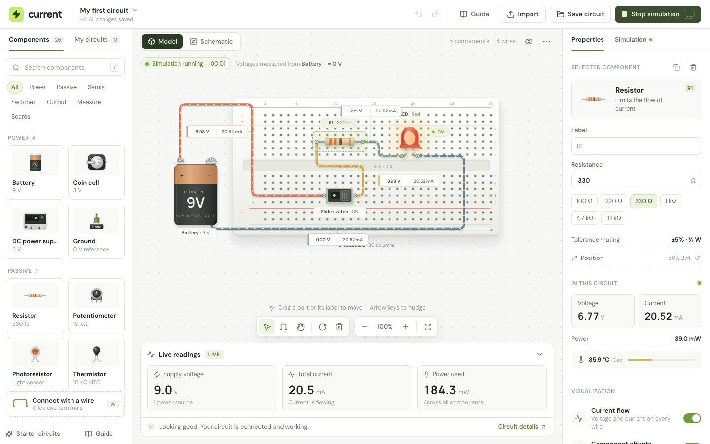
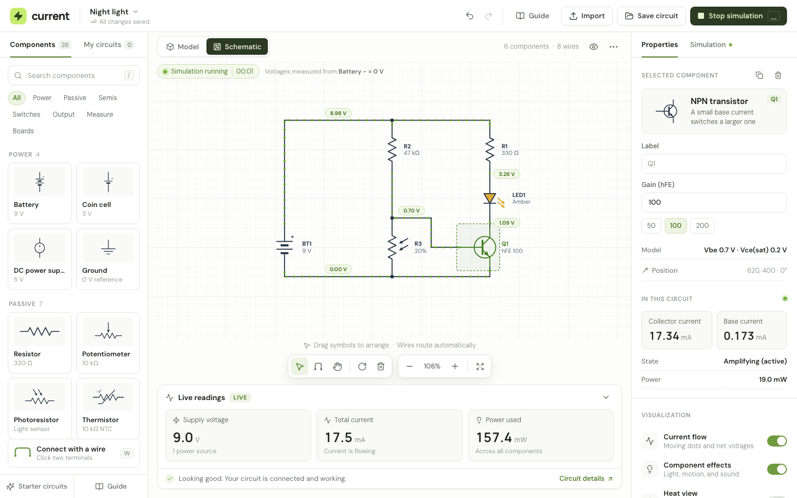

# Current Viewer

An interactive electronics workbench for building and simulating DC circuits in the browser.



Current Viewer combines a visual circuit editor with a steady-state DC solver. Place components, connect their terminals, shape wires, and run the circuit to see current flow, voltage, power, heat, and component effects. Switch between a realistic model of the parts and a schematic diagram of the same circuit, or import an existing schematic from KiCad, LTspice, Eagle, or a SPICE netlist. Everything runs locally in the browser—there is no backend or account to set up.

## Highlights

- Build circuits from 26 parts: batteries, coin cells, a bench power supply, ground, resistors, potentiometers, photoresistors, thermistors, capacitors, inductors, fuses, diodes, zener diodes, LEDs, NPN and PNP transistors, slide, toggle (SPDT), and push-button switches, bulbs, motors, buzzers, speakers, ammeters, voltmeters, and breadboards.
- Toggle between the realistic **Model** view and a **Schematic** view with standard symbols, reference designators, and automatically routed wiring. Both views edit the same circuit.
- Drag and drop (or upload) a KiCad, LTspice, Eagle, or SPICE file to import it as a new project.
- See live voltage and current readings on every wire while the simulation runs.
- Edit wire routes with draggable segments and bend points while endpoints stay connected.
- Simulate series and parallel branches, multiple sources, and breadboard connectivity.
- Catch source shorts and overloaded resistors or LEDs with circuit diagnostics.
- Undo and redo edits, save named circuits in the browser, and import or export JSON files.
- Use the responsive workbench on desktop and mobile.

## Getting started

You need [Node.js](https://nodejs.org/) 18 or newer.

```sh
git clone https://github.com/vbario/Current-Viewer.git
cd Current-Viewer
npm install
npm run dev
```

Open the local URL printed by Vite.

## Using the workbench

Click or drag a part from the component library to add it to the canvas. Select a part to change its value, name, rotation, or exact position.

Press `S` or use the Model / Schematic switch above the canvas to change views. In the schematic, drag symbols to arrange the diagram (placement snaps to a grid and is independent of the workbench layout), and connect pins with `W` just like in the model. Schematic wiring is drawn from the circuit's connections, so it updates as you edit. Click a wire in the schematic to inspect its net.

Press `W`, then select two component terminals or breadboard holes to connect them. Select a wire to change its color or route. You can drag segments and bend points, double-click to add or remove a bend, or reset the route from the Properties panel.

Start the simulation with the Run button or the space bar. Current Viewer displays each component's electrical values and each wire's voltage relative to the first battery's negative terminal. Toggle current animation, component effects, and heat visualization from the Simulation panel.

Circuits are automatically saved to local browser storage. Use the workspace menu to keep named snapshots or move circuits between browsers as JSON files.



### Importing diagrams

Drop a file anywhere on the app, or choose **Import**. Current Viewer reads:

| Format | Files |
| --- | --- |
| KiCad 6+ schematic | `.kicad_sch` |
| KiCad netlist export | `.net` |
| LTspice schematic | `.asc` |
| Eagle / Fusion electronics schematic | `.sch` |
| SPICE netlist | `.cir`, `.sp`, `.spice`, `.ckt`, `.net` |
| Current project | `.json` |

Parts are matched to the component library by reference designator, library symbol, and value. Positions come from the source drawing when it has one; netlists are laid out automatically. Unsupported parts, such as ICs and connectors, are skipped and listed after the import. Power rails like `+5V` without a source get a DC supply so the circuit can still run. Images and PDFs of schematics can't be imported.

### Keyboard shortcuts

| Key | Action |
| --- | --- |
| `V` | Select mode |
| `W` | Wire mode |
| `S` | Switch between model and schematic views |
| `H` | Pan mode |
| `Space` | Start or stop the simulation |
| `R` | Rotate the selected component |
| Arrow keys | Nudge the selected component or wire bend |
| `Shift` + arrow keys | Move a selected component farther |
| `Delete` / `Backspace` | Delete the selection |
| `Ctrl/Cmd` + `Z` | Undo |
| `Ctrl/Cmd` + `Shift` + `Z` | Redo |
| `Ctrl/Cmd` + `S` | Save a named circuit snapshot |
| `/` | Search the component library |
| `Escape` | Cancel the current action |

## Simulation model

The solver uses modified nodal analysis for steady-state DC circuits. It supports series and parallel branches, multiple voltage sources, wire networks, and breadboard connections.

Sources include internal resistance (1 Ω for the battery, 10 Ω for the coin cell, 0.05 Ω for the bench supply). LEDs, diodes, and zener diodes use piecewise-linear models, and transistors switch between cut-off, active (β × base current), and saturation. Potentiometers divide at their wiper, photoresistors and thermistors follow the light level and temperature, and fuses open once their rating is exceeded. Motors, buzzers, speakers, and bulbs are equivalent resistive loads; ammeters and voltmeters have realistic burden and input resistance. Ground parts share a single 0 V reference node. Capacitors are open circuits and inductors are low-resistance coils at steady state, so charging transients and AC behavior are outside the current scope.

LED brightness follows the calculated current. Heat, motor motion, buzzer waves, and moving current dots are visual aids; they are not physical time-domain simulations.

## Development

```sh
npm run dev       # Start the Vite development server
npm run build     # Create a production build in dist/
npm run preview   # Preview the production build
npm test          # Run solver, schematic router, and importer unit tests
npm run test:e2e  # Run Playwright browser tests
```

Install Playwright's browser before running the end-to-end suite for the first time:

```sh
npx playwright install chromium
```

The app is built with React, Vite, SVG, and Lucide icons. `src/parts.js` is the part registry (pins, geometry for both views, and editable values), `src/circuit.js` is the solver, `src/schematic.js` routes schematic wiring, and `src/importers/` holds the file importers. Unit tests cover the electrical model, router, and importers, while Playwright tests cover editing, wiring, both views, importing, simulation, persistence, responsive behavior, and accessibility-focused interactions.
